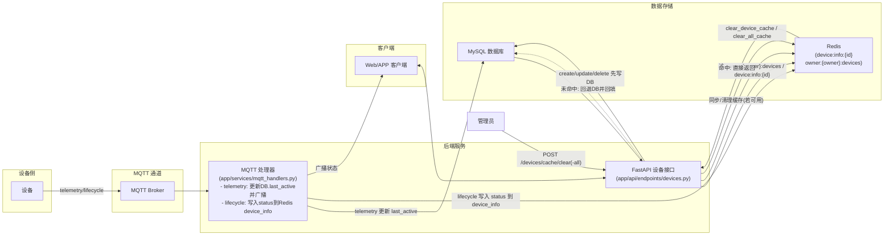

# Redis 配置说明

## 新增功能

### 1. Redis 全局开关
在 `.env` 文件中添加以下配置来控制Redis的启用/禁用：

```bash
# Redis 全局开关 (true/false)
REDIS_ENABLED=true

# Redis 连接配置
REDIS_HOST=localhost
REDIS_PORT=6379
REDIS_DB=0
REDIS_PASSWORD=
```

### 2. 简化的缓存策略
- **只保留 `device_info` 缓存**：存储设备的基础信息（名称、序列号、所有者ID、状态、最后活跃时间、创建时间等）
- **移除其他缓存**：不再缓存设备状态、在线状态、控制命令等
- **在线状态判断**：直接根据数据库中的 `status` 字段判断（status值为'online'时视为在线）

### 3. 缓存管理功能
- **清除所有缓存**：`clear_all_cache()` - 清除当前Redis数据库的所有键
- **清除设备缓存**：`clear_device_cache()` - 只清除设备相关的缓存（设备信息和用户索引）
- **API端点**：提供REST API来管理缓存（需要管理员权限）

## 缓存结构

### device:info:{device_id}
```json
{
  "id": 1,
  "name": "设备名称",
  "serial_number": "序列号",
  "owner_id": 123,
  "status": "online",
  "last_active": "2024-01-01T12:00:00",
  "created_at": "2024-01-01T10:00:00"
}
```

### owner:{owner_id}:devices
- 类型：Set
- 存储：用户拥有的设备ID列表
- TTL：30分钟

## 缓存与数据流转图



说明：
- **读取**：API 先读 `owner:{owner}:devices` 列表和 `device:info:{id}` 详情；未命中则回退 DB 并回填 Redis。
- **写入**：增删改先写 DB，再同步更新或清理 Redis（若 `REDIS_ENABLED=true` 且连接可用）。
- **MQTT**：
  - telemetry：更新数据库中的 `last_active` 并广播给前端；不直接写入在线状态。
  - lifecycle：将在线状态映射为 `status` 字段写入 `device_info`。
- **清理**：提供 `POST /devices/cache/clear` 与 `POST /devices/cache/clear-all` 管理端接口，调用 `redis_service` 的清理方法。

## 同步策略

### 增删改操作自动同步Redis
- **创建设备**：自动添加到Redis缓存和用户索引
- **更新设备**：自动更新Redis缓存
- **删除设备**：自动清理Redis缓存和用户索引

### 缓存失效处理
- 如果Redis不可用，自动回退到数据库查询
- 缓存未命中时，从数据库获取数据并回填缓存
- 所有Redis操作都有异常处理，不会影响主要业务流程

## 缓存管理API

### 清除设备缓存
```http
POST /api/v1/devices/cache/clear
Authorization: Bearer <token>
```

**权限要求**：管理员权限

**响应**：
```json
{
  "message": "Device cache cleared successfully"
}
```

### 清除所有缓存
```http
POST /api/v1/devices/cache/clear-all
Authorization: Bearer <token>
```

**权限要求**：管理员权限

**响应**：
```json
{
  "message": "All cache cleared successfully"
}
```

## 使用示例

### 启用Redis
```bash
REDIS_ENABLED=true
```

### 禁用Redis
```bash
REDIS_ENABLED=false
```

当Redis被禁用时：
- 所有缓存操作会被跳过
- 系统直接使用数据库
- 日志中会显示相应的警告信息

### 程序化清除缓存
```python
from app.services.redis_service import redis_service

# 清除所有缓存
await redis_service.clear_all_cache()

# 只清除设备相关缓存
await redis_service.clear_device_cache()
```

## 注意事项

1. **优雅降级**：Redis不可用时，系统会自动回退到数据库操作
2. **性能优化**：只缓存相对稳定的设备信息，避免频繁更新
3. **数据一致性**：增删改操作会同步更新Redis缓存，确保数据一致性
4. **在线状态**：设备的在线状态完全由数据库中的 `status` 字段决定，不再根据 `last_active` 时间推断
5. **缓存管理**：清除缓存操作需要管理员权限，请谨慎使用
6. **清除影响**：清除缓存后，下次请求会重新从数据库加载数据并重建缓存
